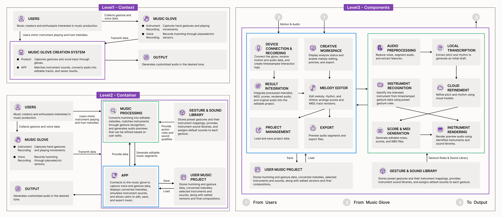

# 音乐手套创作系统架构

> 文档状态：已确认的 Level 1-3 最终架构基线  
> 版本：1.4  
> 最后更新：2026-10-16  
> 适用范围：产品概念、系统边界、Level 1-3 架构与核心数据流  
> 唯一现行架构图：[Level 1-3 最终合并图](diagrams/music-glove-architecture-level1-3-final.png)

## 1. 文档定位

本文档是音乐手套创作系统的架构 source of truth，用于统一产品、设计、开发和后续文档中的系统认知。

- Level 1、Level 2 与 Level 3 以同一张最终合并图为视觉基线。
- 旧版三张分级图已移出 `truth/`，只作为历史参考保存，不再参与实现判断。
- 本文档把最终图中的英文节点、边界和数据流转换为可检索的中文说明。
- 当前图已修正组件归属、标签和项目读写关系；为排版省略的跨容器连线按第 10 节的正式解释执行。
- 尚未决定的技术选型统一列在“当前不做限定的实现细节”中，不把推测写成事实。

如图与本文档发生冲突，应先停止冲突部分的实现并核对事实来源，不得自行选择方便的一份继续施工。

## 2. 系统概述

音乐手套创作系统面向音乐创作者，以及喜欢或热衷音乐创作的普通用户。用户佩戴音乐手套，用双手共同模拟吉他、钢琴、鼓等乐器的演奏动作，并同时哼唱旋律。

音乐手套采集动作和由压电传感器记录的哼唱数据。系统通过 App 和 Music Processing 完成乐器识别、旋律转写、云端精修、乐谱与 MIDI 生成、乐器渲染、编辑、项目保存和导出，最终生成用户期望音色的音乐输出。

系统的核心创作逻辑是：

> 哼唱决定“演奏什么”，双手动作决定“使用什么乐器”，App 与 Music Processing 负责转换、编辑、试听、保存与导出。

## 3. 已确认的领域规则

| 编号 | 已确认规则 |
| --- | --- |
| R-01 | 手势只用于识别用户模拟的乐器类型，例如吉他、钢琴或鼓。 |
| R-02 | 手势不直接生成音符，也不负责力度、延音、颤音等连续演奏控制。 |
| R-03 | 乐器动作由两只手共同形成；两只手套功能相同。 |
| R-04 | 哼唱需要识别音高、节奏等能够用乐谱或曲段表达的音乐信息。 |
| R-05 | 歌词和用户自身的音色不参与乐谱与 MIDI 的生成。 |
| R-06 | 原始哼唱音频必须保留，用户可以把它作为独立 Vocal 信息加入后续音乐编辑。 |
| R-07 | 乐器识别优先在本地完成，以获得快速反馈。 |
| R-08 | 哼唱转乐谱/MIDI 采用“本地初步结果 + 云端精修”的处理方式。 |
| R-09 | 哼唱分析允许存在输入与输出之间的时间差，不要求完全实时。 |
| R-10 | 无网络时不要求完成匹配分析，但手套与 App 必须能够可靠记录数据。 |
| R-11 | 网络恢复后，待分析记录进入匹配、云端精修和后续编辑流程。 |
| R-12 | 音乐项目同时保存在本地并同步到云端。 |
| R-13 | 系统需要输出音频、独立 Vocal、MIDI、乐谱和可继续编辑的工程文件。 |

这些规则是对最终图简化表达的必要补充。最终图未画出离线队列、同步冲突和原始 Vocal 保留等横切能力，不代表这些规则被取消。

## 4. Level 1-3 最终合并图



阅读位置：

- 左上：Level 1 — Context。
- 左下：Level 2 — Container。
- 右侧：Level 3 — Components。
- Level 3 的蓝色边界是 Level 2 蓝色 App 容器的展开，绿色边界是 Level 2 绿色 Music Processing 容器的展开。
- Level 3 底部编号 `1`、`2`、`3` 分别表示 From Users、From Music Glove、To Output；Users、Music Glove、Output 因排版而简化为编号，不是新增组件。

## 5. Level 1：系统上下文

### 5.1 外部参与者与系统

| 元素 | 角色 |
| --- | --- |
| Users | 对音乐制作感兴趣的音乐创作者与爱好者；模拟乐器演奏并哼唱旋律。 |
| Music Glove | 采集手势和演奏动作，并通过压电传感器记录哼唱。 |
| Music Glove Creation System | 接收手套采集的数据，完成乐器匹配、旋律转换、编辑和保存。 |
| Output | 生成用户期望音色的定制音频。 |

### 5.2 上下文数据流

1. Users 向 Music Glove 提供手势和哼唱数据。
2. Users 通过模拟演奏与哼唱来使用 Music Glove Creation System。
3. Music Glove 将采集数据传输给 Music Glove Creation System。
4. Music Glove Creation System 生成 Output。

Level 1 只表达系统与外部对象的关系，不规定通信协议、文件格式、部署位置或模型类型。

## 6. Level 2：容器与系统边界

最终图的紫色边界内包含四个容器/数据存储：App、Music Processing、Gesture & Sound Library、User Music Project。Users、Music Glove 和 Output 均位于系统边界之外。

### 6.1 App

- 连接 Music Glove 并采集动作与哼唱数据。
- 展示转换后的旋律。
- 模拟不同乐器的声音。
- 允许用户编辑、保存和导出音乐。
- 向 Music Processing 提供数据，并接收可编辑音乐片段。
- 与 User Music Project 执行 Save 和 Load。

### 6.2 Music Processing

- 把哼唱转换为可编辑旋律。
- 根据手势识别结果匹配目标乐器。
- 生成可根据用户编辑继续调整的音频预览。
- 接收 Music Glove 传输的数据，也接收 App 提供的处理输入。
- 使用 Gesture & Sound Library 提供的动作规则与音色属性。

### 6.3 Gesture & Sound Library

- 保存预设手势及其乐器映射。
- 提供乐器音色库。
- 为每个手势分配默认音色。
- 向 Music Processing 提供动作规则与音色属性。

### 6.4 User Music Project

- 保存哼唱与手势数据。
- 保存转换后的旋律、选定的乐器与音色。
- 保存编辑版本和最终作品。
- 在 Level 2 中通过 App 执行 Save 和 Load。

### 6.5 外部元素

- Users：提供创作行为并使用 App。
- Music Glove：采集并传输动作与声音数据。
- Output：接收整个 Music Glove Creation System 的输出；Level 2 箭头连接紫色系统边界，不表示由邻近的 App 单独负责。

## 7. Level 3：组件展开

Level 3 同时展开 App 和 Music Processing 两个核心容器，并保留 Gesture & Sound Library、User Music Project 与 Output 的协作关系。蓝色和绿色各包含 6 个组件。

### 7.1 App 组件

| 最终图组件 | 中文名称 | 职责 |
| --- | --- | --- |
| Device Connection & Recording | 设备连接与录制 | 连接手套，接收动作与音频数据，并建立带时间戳的交互记录。 |
| Creative Workspace | 创作工作台 | 展示分析状态，支持旋律编辑、预览与导出入口。 |
| Result Integration | 结果集成 | 把处理后的旋律、MIDI、乐谱、渲染音频和原始音频集成到可编辑项目中。 |
| Melody Editor | 旋律编辑器 | 编辑旋律、节奏与音色，整理乐谱与 MIDI，并追踪修订版本。 |
| Project Management | 项目管理 | 加载和保存项目数据。 |
| Export | 导出 | 预览音频片段并导出文件。 |

图中明确连线包括：

- Device Connection & Recording → Result Integration。
- Creative Workspace → Melody Editor。
- Result Integration → Melody Editor。
- Melody Editor → Project Management。
- Melody Editor → Export。

### 7.2 Music Processing 组件

| 最终图组件 | 中文名称 | 职责 |
| --- | --- | --- |
| Audio Preprocessing | 音频预处理 | 降噪、分段，并提取可分析特征。 |
| Local Transcription | 本地转写 | 提取音高与节奏，生成初步草稿。 |
| Instrument Recognition | 乐器识别 | 根据带时间戳的手势数据和预设动作规则识别目标乐器。 |
| Cloud Refinement | 云端精修 | 使用云端模型校正音高与节奏。 |
| Score & MIDI Generation | 乐谱与 MIDI 生成 | 生成可编辑音符、乐谱和 MIDI 文件。 |
| Instrument Rendering | 乐器渲染 | 使用识别出的乐器和音色库生成试听音频。 |

图中处理主链路为：

```text
Audio Preprocessing
  → Local Transcription
  → Cloud Refinement
  → Score & MIDI Generation
  → Instrument Rendering

Instrument Recognition
  → Instrument Rendering
```

### 7.3 支撑数据

- Gesture & Sound Library 保存动作规则、乐器映射、音色库和默认音色，并向 Music Processing 提供这些资源。
- User Music Project 保存哼唱、手势、转换旋律、选定乐器/音色、编辑版本与最终作品。
- Level 3 由蓝色 App 容器与 User Music Project 执行 Save/Load，与 Level 2 保持一致；具体组件职责由 Project Management 承担。

## 8. 核心运行流程

### 8.1 在线创作流程

1. 用户操作音乐手套并哼唱旋律。
2. Device Connection & Recording 建立录制会话，以时间戳关联动作与振动音频，并把两类数据交给 Music Processing。
3. Instrument Recognition 根据动作识别目标乐器。
4. Audio Preprocessing 和 Local Transcription 产生初步旋律草稿。
5. Cloud Refinement 校正音高和节奏。
6. Score & MIDI Generation 生成可编辑音符、乐谱与 MIDI。
7. Instrument Rendering 使用识别出的乐器与音色库生成试听音频。
8. Music Processing 把识别、转写、乐谱/MIDI 和渲染结果返回 App；Result Integration 将这些结果与原始音频组装进可编辑项目。
9. Melody Editor 接收结构化音乐结果，用户继续编辑旋律、节奏与音色。
10. Project Management 保存项目，Export 预览并导出文件。

为排版简洁，最终图用蓝绿边界之间的箭头概括第 2～8 步的跨容器数据流，没有逐组件画线；完整语义见第 10 节。

### 8.2 离线记录与恢复流程

最终图没有单独绘制离线组件，离线能力按 R-10～R-12 作为 App、Music Processing 与 User Music Project 的横切职责实现：

1. 无网络时，Music Glove 与 App 继续完成动作和声音数据采集。
2. App 可靠保存完整录制会话、时间戳和本地乐器识别结果。
3. 记录进入“待上传”状态，不承诺当时完成云端精修。
4. 网络恢复后，原任务继续 Cloud Refinement 与后续处理。
5. 结果合并回原项目；失败重试不得创建重复项目。

### 8.3 编辑、保存与导出流程

1. Melody Editor 读取结构化分析结果和现有项目版本。
2. 用户修改旋律、节奏与音色，并决定是否使用原始 Vocal。
3. Music Processing 根据修改重新生成乐谱、MIDI 和试听结果。
4. Project Management 保存项目数据与修订版本。
5. Export 预览音频片段并导出音频、独立 Vocal、MIDI、乐谱或工程文件。

## 9. 核心数据与状态

### 9.1 核心数据

| 数据 | 来源 | 主要用途 | 保存位置 |
| --- | --- | --- | --- |
| 双手动作数据 | Music Glove | Instrument Recognition | User Music Project，本地并同步云端 |
| 原始哼唱音频 | Music Glove 的压电传感器 | 音乐分析；作为可选 Vocal | User Music Project，本地并同步云端 |
| 时间戳与会话信息 | App | 对齐动作与声音；恢复离线任务 | User Music Project |
| 乐器识别结果 | Instrument Recognition | 选择乐器与音色 | User Music Project |
| 初步旋律草稿 | Local Transcription | 预览与 Cloud Refinement 输入 | User Music Project |
| 精修音乐信息 | Cloud Refinement | 生成乐谱、音符与 MIDI | User Music Project |
| 乐谱与 MIDI | Score & MIDI Generation | 编辑、播放与导出 | User Music Project |
| 试听音频 | Instrument Rendering | 试听与确认 | User Music Project 或可重建缓存 |
| 集成结果 | Result Integration | App 编辑、保存与输出 | User Music Project |
| 修改版本 | Melody Editor | 撤销、继续编辑与版本追踪 | User Music Project |

### 9.2 分析任务状态

离线与云端分析任务至少表达：

- `待上传`：已在本地可靠保存，尚未提交云端。
- `分析中`：数据已提交，正在执行 Cloud Refinement 或后续处理。
- `已完成`：集成结果已写入原项目。
- `分析失败`：可以重试，原始记录不得丢失。

## 10. Level 3 图面简化的正式解释

### 10.1 蓝色到绿色的数据流

为保持图面整洁，Level 3 没有画出每一条跨容器运行时连线。蓝色 App 到绿色 Music Processing 的箭头正式表示：

- Device Connection & Recording 把同一录制会话内、带统一时间戳的动作数据交给 Instrument Recognition。
- Device Connection & Recording 把同一录制会话内的振动音频交给 Audio Preprocessing。
- Melody Editor 可提交重新转写、重新生成或重新渲染请求，但不能覆盖原始采集资产。

### 10.2 绿色到蓝色的数据流

绿色 Music Processing 到蓝色 App 的箭头正式表示：

- 返回乐器识别结果、本地旋律草稿、云端精修结果、乐谱、MIDI 和渲染音频。
- Result Integration 接收上述派生结果，将其与 App 保留的原始音频和项目元数据组装为可编辑项目。
- 数据流必须使用稳定的录制会话、项目、任务和结果标识关联，不能依赖隐式共享状态。

### 10.3 支撑资源与外部编号

- Gesture & Sound Library 向 Instrument Recognition 提供动作规则，向 Instrument Rendering 提供音色资源。
- User Music Project 由 App 通过 Save/Load 读写；Project Management 承担具体项目管理职责。
- 编号 `1`、`2`、`3` 分别是 Users、Music Glove 和 Output 的简化表示，不是 Level 3 新组件。

### 10.4 Output 连线的阅读方式

- Level 2 的箭头从紫色 Music Glove Creation System 边界指向 Output，并非 App → Output；箭头靠近 App 只是排版结果。
- Level 3 的编号 `3` 是对系统外部 Output 的简化表示，也不表示 Result Integration 单独拥有整个输出职责。
- Result Integration 负责组装可编辑项目，Export 负责预览和导出文件，Music Processing 负责生成结构化和渲染结果；三者共同支撑系统到 Output 的内部实现。

因此不需要为了 Output 再增加逐组件跨容器箭头；工程实现必须保证最终产物从系统边界一致交付。

## 11. 架构约束

- 动作与声音必须属于同一个录制会话，并通过时间戳保持同步。
- 原始数据先进入 App 的 Device Connection & Recording，再按第 10.1 节的运行逻辑交给 Music Processing。
- Instrument Recognition 位于 Music Processing，并使用 Gesture & Sound Library 的动作规则。
- Audio Preprocessing、Local Transcription、Instrument Recognition、Cloud Refinement、Score & MIDI Generation 与 Instrument Rendering 位于 Music Processing 内。
- Result Integration 位于 App 内，负责将派生结果与原始音频整合进可编辑项目。
- 离线存储与同步是 App、Music Processing 和 User Music Project 的横切职责，最终图未把它单列为组件。
- 无网络时优先保证原始数据可靠保存，不强行完成云端处理。
- 上传和云端分析支持失败重试，并避免重复创建项目或结果。
- 原始哼唱音频不能因乐谱转换而被覆盖或丢弃。
- 转换结果保持可编辑性，不能只返回扁平化音频。
- User Music Project 保留原始输入、中间结果、用户修改和最终输出。
- 不得因为图上省略连线而实现第二套识别、设备接入或导出责任链。

## 12. 当前不做限定的实现细节

以下事项尚未决定，不应由当前架构图擅自限定；已经通过 ADR 确认的首版方向同时列出，避免实现与决策脱节：

- Music Glove 与 iPhone 的首版传输方向已确定为 Bluetooth Low Energy；GATT 服务、特征、分包、双手身份和时间同步协议仍待硬件规格确认。
- 摄像头、压电传感器的具体型号、安装位置和机械结构。
- 首版手机端已确定为 iPhone 原生 SwiftUI；客户端数据库与本地音乐模型仍待确认。
- MVP 分析服务已确定为 Python/FastAPI，使用 Spotify Basic Pitch 转 MIDI，并以 FluidSynth 和授权 SoundFont 渲染试听；云服务提供商、生产部署与持久任务系统仍待确认。
- 云端数据库、对象存储和同步协议的具体产品。
- 音频、乐谱、MIDI 和工程文件的具体格式与编码参数。
- 用户账户、跨设备协作、分享和权限体系。

这些事项应在进入技术选型或实现阶段后，通过独立架构决策记录（ADR）补充。

当前已接受的决策见：[ADR-001](adr/ADR-001-ios-swiftui-mvp.md)、[ADR-002](adr/ADR-002-ble-transport-direction.md) 和 [ADR-006](adr/ADR-006-mvp-analysis-api.md)。

## 13. 变更规则

- 本版 Level 1～3 合并图是已确认的当前视觉基线；未经用户明确批准，不得重新划分图中的容器和组件边界。
- 后续修改图时，应从可编辑图源重新导出，并在同一变更中更新本文档、工程文档和变更记录。
- 技术选型不能破坏离线可靠记录、原始 Vocal 保留、本地快速识别和云端精修等核心能力。
- 如果代码、设计稿或其他说明与本文档冲突，应先确认需求并更新 truth，再修改实现。

## 14. 关联文件

- [Level 1-3 最终合并图](diagrams/music-glove-architecture-level1-3-final.png)
- 旧版三张分级图仅供追溯，位于 `../reference/superseded-diagrams/2026-10-09/`，不再是 truth。
- 上一版合并图位于 `../reference/superseded-diagrams/2026-10-15-revision-1/`，不再是 truth。
- 本次定稿前的上一版合并图位于 `../reference/superseded-diagrams/2026-10-16-revision-2/`，不再是 truth。
- 可编辑图源当前未收录；后续补充时放入 `tool/diagram/` 并在此登记。
