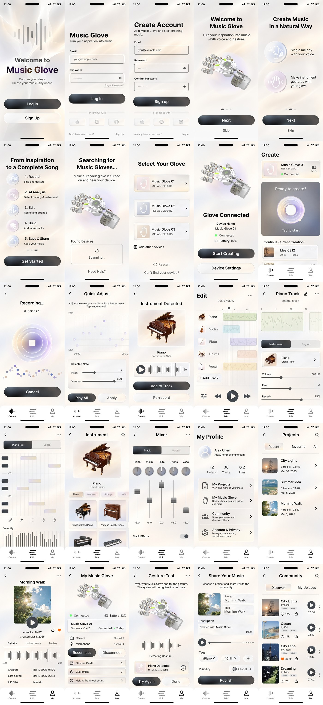

# 音乐手套手机 App 设计规范

> 文档状态：高保真设计基线  
> 版本：1.0  
> 最后更新：2026-10-09  
> 设计来源：`高保真/` 中的 25 张手机界面  
> 关联架构：[architecture.md](architecture.md)

## 1. 文档定位

本文档是音乐手套手机 App 的设计 truth，用于统一产品、设计、开发、测试和验收中的页面认知。

- 高保真原图定义页面结构、视觉层级、功能入口和主要交互。
- 本文档补充页面职责、异步状态、离线行为、可访问性和实现约束。
- 图片中的示例项目、用户、时间和数据是演示内容，不代表固定业务数据。
- 高保真未展示但架构要求必须存在的状态，在本文档中标记为“实现必需状态”。

## 2. 设计总览：

该产品和APP面向期望创作音乐的人群，帮助他们在没有乐器或者不熟悉乐器技能的情况下，将哼唱转换为期望音色的乐曲。
产品负责记录用户的手部动作和哼唱音频；APP负责将用户动作匹配为期望的乐器音色，将用户哼唱的音频转换为可编辑的乐段并输出用户期望音色的对应旋律，提供二次编辑（包含乐器音色和曲段），可保存、导出和发布到社区。

## 3. 信息架构与导航

### 3.1 主导航

| 标签 | 核心职责 | 主要内容 |
| --- | --- | --- |
| Create | 开始或继续一次创作 | 手套状态、录制入口、继续当前创作、分析结果 |
| Edit | 编辑当前音乐工程 | 多轨时间线、轨道详情、旋律编辑、乐器选择、混音 |
| Me | 管理个人内容与设备 | 用户资料、项目、音乐手套、社区、账户与隐私 |

### 5.多轨编辑
交互要求：
- 播放头、轨道块和时间刻度必须保持同步。
- 编辑操作至少支持撤销与重做。
- 音符拖动、调整长度或区域选择必须提供可见工具，不能只依赖隐藏手势。
- Slider、Knob、Fader 必须显示名称与当前值，并支持无障碍增减。
- 切换乐器后保留原始音符，只替换音色并重新渲染试听。
- 保存中、已保存、保存失败和同步冲突需要可见状态。

## 6. 组件规范

### 6.1 主要按钮
- Disabled 状态降低对比度但仍需可读，并提供不可用原因。
- Loading 状态保留按钮尺寸，显示进度并防止重复提交。

### 6.2 次要按钮
- 用于 Device Settings、Re-record、Done、Disconnect 等次要操作。

### 6.3 输入框
- 上方保留字段标签，不用 placeholder 代替标签。
- 键盘出现时字段和提交按钮必须保持可达。

### 6.4 卡片与列表行
- 整行可点击，而不是只允许点击右侧箭头。
- 卡片至少包含主要标题；根据类型补充缩略图、状态、时长、日期或设备信息。
- 列表必须提供 Loading、Empty、Error、Offline 和 Retry 状态。
- Projects、Instrument、Community 使用虚拟化列表或网格，不能渲染无限长 ScrollView。

### 6.5 Bottom Navigation
- 固定三个目的地：Create、Edit、Me。
- 选中状态同时使用图标颜色和文字颜色表达
- 深层页面保持当前主标签选中；返回由堆栈导航处理。

### 6.6 Segmented Control
用于 Piano Roll/Score、Track/Master、Instrument/Region、Discover/My Uploads 等同级视图切换。
- 选中项使用深色或高对比表面。
- 未选项保持可读。
- 切换不创建新的导航层级，应保留当前对象和编辑上下文。

### 6.7 音频与音乐控件
- Transport controls 包含播放/暂停、前后定位和当前位置。
- 波形与时间轴需要明确起止时间。
- Slider、Knob、Fader 必须有可读标签、数值和无障碍调整方式。
- Piano Roll 支持音符选择、绘制、擦除、区域选择、撤销/重做和 Velocity 编辑。
- 多轨颜色需要同时配合轨道名称与图标，不能仅靠颜色区分。

## 7. 可访问性与平台要求
- 所有图标按钮必须有可访问名称，例如 Back、Search、Play、Share、Favorite。
- 页面状态不能只通过绿色、橙色或轨道颜色表达。
- 正文、辅助文字和半透明表面必须满足实际设备上的对比度要求。
- 支持屏幕阅读器的合理遍历顺序，特别是多轨、Piano Roll、Mixer 和 Community。
- Slider、Knob 和 Fader 暴露名称、最小值、最大值、当前值及增减操作。
- 音频波形提供时长、当前位置和播放状态的文本替代。
- 支持 Dynamic Type/字体缩放，必要时将横向密集控件改为可滚动或分层视图。
- 支持 Reduce Motion，减少录制圆环和装饰光效动画。
- iOS 支持边缘返回；Android 支持系统 Back，不用自定义逻辑阻断标准返回。
- 触觉反馈用于录制开始/停止、配对成功和关键操作确认，但不能作为唯一反馈。

## 8. 性能与媒体约
- Projects、Instrument 和 Community 列表使用虚拟化和稳定数据 ID。
- 封面图根据显示尺寸生成缩略图，避免加载原始大图。
- 波形使用预计算/降采样数据，不在每次滚动或重绘时解析完整音频。
- 同一时间只维持一个主音频播放实例，离开页面时正确释放或转交播放状态。
- 录制和渲染过程需要处理应用进入后台、电话中断和系统音频焦点变化。
- 离线队列、录制文件和导出文件需要明确存储空间管理及失败提示。
- 动画优先使用 transform/opacity，避免高频修改布局属性。

## 9. 验收基线
- 25 个高保真页面的结构、信息层级和主要交互可对应。
- 核心闭环可以完成：配对、录制、分析、加入轨道、编辑、保存、导出。
- 原始 Vocal、转换后的 MIDI/乐谱及编辑项目可以分别保留。
- 关键控件满足触控尺寸、安全区域、字体缩放和屏幕阅读器要求。
- 长列表、图片、波形和音频播放满足性能约束。
- 破坏性操作有确认或撤销，后台切换和网络中断不会丢失用户工作。

## 10. 变更规则
- 修改页面信息架构、核心流程、底部导航或离线承诺前，必须先更新本文档。
- 视觉微调不得改变已经确认的业务语义与架构规则。
- 新增页面时需要补充页面清单、导航关系、状态矩阵和验收标准。
- 若实现与高保真冲突，应先确认设计变更，再同步修改truth。
