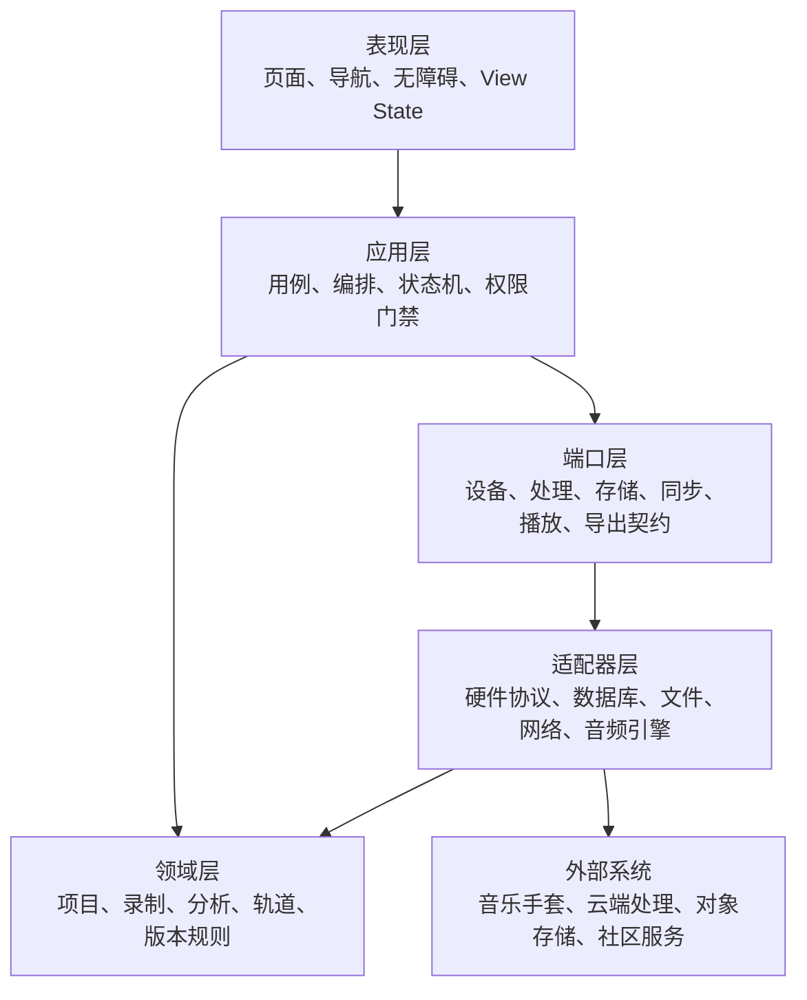
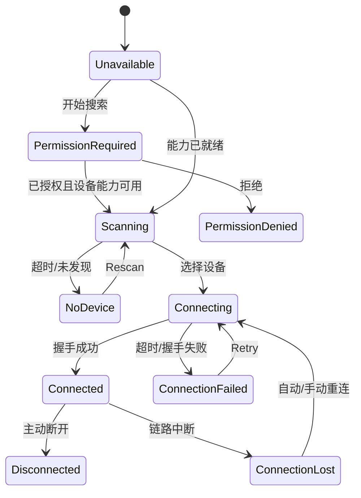
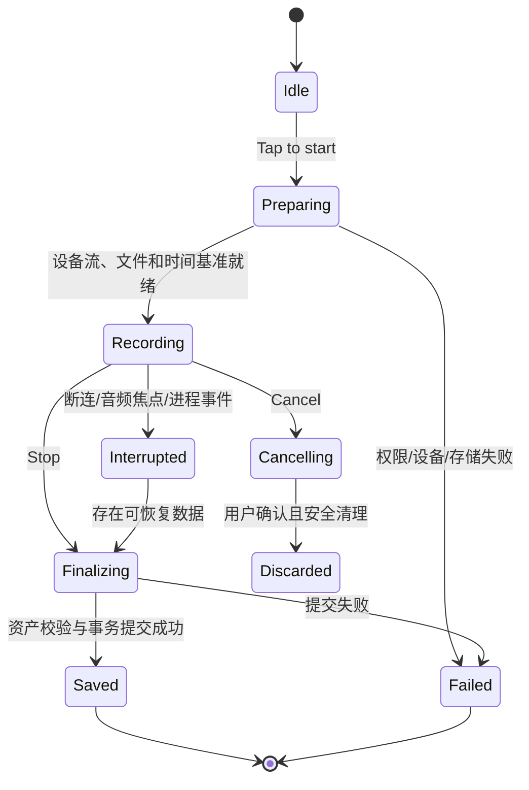
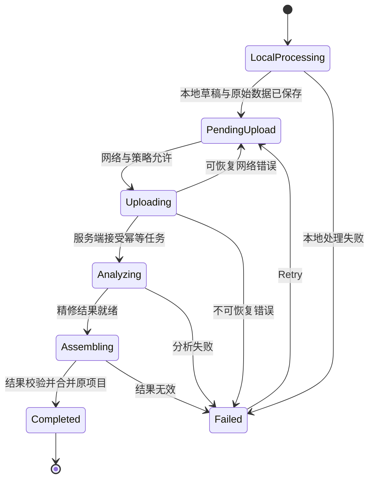

# 音乐手套创作系统工程文档

> 文档状态：工程实施基线（已同步最终 Level 1-3 图；技术选型待决）  
> 版本：1.3  
> 最后更新：2026-10-16  
> 输入基线：[设计文档](design.md) · [架构文档](architecture.md)  
> 适用范围：手机 App、端侧音乐处理、云端音乐处理、项目同步、导出与社区能力的工程实现

## 1. 文档定位

本文档把已经确认的产品设计和系统架构转换为可实施、可测试、可追踪的工程规格。它定义模块边界、领域模型、状态机、接口语义、数据可靠性、异常处理和交付门禁，但不替代上游设计与架构基线。

规范用语：

- **必须**：上线前不可缺少；不满足即不能通过验收。
- **应该**：默认实现，只有记录充分理由后才可偏离。
- **可以**：实现选择，不构成验收硬条件。
- **待决定**：当前 source of truth 没有结论，必须通过 ADR（Architecture Decision Record）确认，不能在实现中悄悄固化。

冲突处理规则：

1. 已确认领域规则与最终 Level 1-3 合并图的架构边界优先级最高；图中为排版省略的跨容器数据流按架构文档第 10 节处理。
2. 页面结构、体验状态和交互以设计文档及高保真为准。
3. 本文档只细化实现，不得改变上游语义。
4. 若三者出现冲突，暂停冲突部分的实现，先更新对应 source of truth，再同步修改本文档和代码。

## 2. 工程目标与边界

### 2.1 首要工程目标

系统必须可靠完成以下闭环：

1. 连接一双功能相同的音乐手套。
2. 在同一录制会话中采集双手动作、哼唱振动音频和统一时间信息。
3. 本地快速识别用户模拟的乐器，并生成可预览的初步旋律。
4. 在线时提交云端精修；离线时可靠保存并在恢复联网后继续。
5. 生成并保留可编辑旋律、乐谱、MIDI、试听音频和原始 Vocal。
6. 支持多轨、音符、音色和混音编辑，自动保存并保留版本。
7. 导出用户选择的产物；在社区范围确认后支持发布和管理。

### 2.2 本文档不做的决定

以下内容中，首版方向已通过 ADR 确认；未被 ADR 覆盖的部分仍不得假定为事实：

- 首版客户端为 iPhone 原生 SwiftUI；Android 范围与 iOS 最低支持版本的最终结论仍待确认。
- 手套与手机采用 Bluetooth Low Energy 方向；具体 GATT、分包、双手身份、时间同步与固件协议仍待确认。
- MVP 服务端为 Python/FastAPI；客户端数据库、云服务商、对象存储和持久任务系统仍待确认。
- MVP 使用 Spotify Basic Pitch 生成 MIDI，并使用 FluidSynth 与外部授权 SoundFont 生成试听；本地初步转写模型、音频编解码器、乐谱格式、工程文件格式及具体参数仍待确认。
- 第三方登录供应商、社区是否进入首版、内容审核与隐私体系。
- 单双手设备身份、电量展示方式和固件升级协议。

未决项不妨碍领域层、用例层和接口适配层的开发，但依赖真实协议、格式或供应商的功能不得以假数据宣称完成。

## 3. 不可破坏的工程约束

| 编号 | 工程约束 | 验证方式 |
| --- | --- | --- |
| E-01 | 手势仅决定乐器类型，不生成音符或连续演奏参数。 | 领域单元测试、模型输入审查 |
| E-02 | 音高、节奏和音符来自哼唱分析；歌词和用户音色不进入 MIDI/乐谱生成。 | 音乐处理契约测试 |
| E-03 | 双手动作共同参与一次乐器识别，两只手套功能相同。 | 硬件在环测试 |
| E-04 | 原始哼唱作为不可变资产保留，可独立加入 Vocal 轨。 | 数据迁移与故障注入测试 |
| E-05 | 动作、音频与时间戳必须属于同一录制会话。 | 会话完整性校验 |
| E-06 | 无网时允许录制；原始数据落盘成功后才能向用户显示“已保存”。 | 断网、杀进程、存储不足测试 |
| E-07 | 上传和分析重试必须幂等，不得产生重复项目或重复结果。 | API 契约与重放测试 |
| E-08 | 转换结果必须保持可编辑结构，不能只保存扁平音频。 | 项目重开与编辑测试 |
| E-09 | 项目同时支持本地保存和云端同步，且同步失败不阻断本地编辑。 | 多端/离线同步测试 |
| E-10 | 所有异步功能都有进行中、空、错误、离线和重试语义。 | 页面状态矩阵测试 |

## 4. 总体工程分层



依赖方向必须从表现层指向抽象和领域规则。页面、数据库、网络 SDK 和硬件 SDK 不得直接相互调用；它们通过应用用例和端口契约协作，以便替换尚未决定的技术方案。

### 4.1 模块与架构组件映射

| 工程模块 | 对应架构组件 | 主要职责 | 禁止承担 |
| --- | --- | --- | --- |
| `device-session` | Device Connection & Recording | 扫描、配对、连接、动作/音频接收、带时间戳会话 | 云端分析、项目 UI |
| `creation-workbench` | Creative Workspace | 编排录制、展示分析状态、进入编辑、预览与导出 | 直接解析硬件协议 |
| `instrument-recognition` | Instrument Recognition | 在 Music Processing 内本地处理双手组合动作，输出乐器和置信度 | 输出音符、力度或延音 |
| `local-transcription` | Audio Preprocessing、Local Transcription | 降噪、分段、初步音高与节奏、旋律草稿 | 覆盖原始 Vocal |
| `analysis-orchestration` | Cloud Refinement、Score & MIDI Generation | 幂等任务、云端精修、结构化结果生成与校验 | 创建重复项目 |
| `result-integration` | Result Integration | 在 App 内把处理结果、原始音频和项目元数据组装为可编辑项目 | 覆盖原始资产或直接承担音乐处理 |
| `project-editor` | Melody Editor | 多轨、音符、节奏、音色、混音、撤销/重做 | 修改原始采集资产 |
| `project-store` | Project Management、User Music Project | 事务保存、资产索引、版本、同步元数据 | 让 Music Processing 直接拥有持久化 |
| `playback-export` | Instrument Rendering、Export | 单一播放会话、乐器渲染、预览与格式导出 | 静默丢弃不支持的轨道 |
| `preset-library` | Gesture & Sound Library | 动作规则、乐器映射、音色资源与默认音色 | 保存用户项目 |
| `offline-sync` | 最终图未单独命名的横切能力 | 离线落盘、上传续传、任务恢复和冲突状态 | 改变 R-10～R-12 的离线承诺 |
| `identity-profile` | 最终图未展开的设计功能 | 登录、会话身份、资料与项目入口 | 保存密码明文 |
| `community` | 最终图未展开的设计功能 | 草稿、发布、Discover、My Uploads | 离线伪造发布成功 |

最终图没有把离线同步、身份和社区画成 Level 3 组件；它们仍由已确认领域规则和设计文档要求驱动。工程上把这些能力实现为横切模块或外围功能，不得擅自加入核心容器图并改变系统边界。

Level 3 已确认蓝色为 App、绿色为 Music Processing。架构图为排版省略了逐组件跨容器连线，正式接口语义以架构文档第 10 节为准：App 发送带会话标识的动作、音频与重处理请求，Music Processing 返回识别、转写、乐谱/MIDI 和渲染结果。实现不得用隐式共享状态代替这些正式数据流。

### 4.2 推荐的代码组织

首版语言和框架已由 ADR-001、ADR-002 与 ADR-006 部分确认，但代码库仍须保持下列逻辑边界：

```text
src/
  domain/           # 无 UI、网络、数据库依赖的实体和值对象
  application/      # 用例、状态机、任务编排
  ports/            # 设备、存储、网络、音频、导出接口
  infrastructure/   # 各端口的具体适配器
  features/         # 按页面域组织的 UI 与 View State
  design-system/    # Token、基础组件、无障碍封装
  observability/    # 日志、指标、追踪、崩溃信息
tests/
  unit/
  contract/
  integration/
  e2e/
  hardware-in-loop/
```

如果最终框架要求不同的目录结构，必须保留同等的依赖边界，而不是机械保持目录名称。

## 5. 核心领域模型

### 5.1 实体与聚合

| 实体/值对象 | 关键字段 | 规则 |
| --- | --- | --- |
| `User` | `userId`、资料、认证关联 | 认证凭据由认证系统管理，不写入项目数据 |
| `GloveSet` | `gloveSetId`、显示名、设备成员、固件、电量、连接状态 | 表示“一双手套”的业务对象；左右标识方式待协议确认 |
| `RecordingSession` | `sessionId`、`projectId`、时间基准、起止时间、采集状态、资产引用 | 动作与音频共享 `sessionId` 和时间基准；停止后不可再追加原始数据 |
| `RawAsset` | `assetId`、类型、URI、大小、校验和、创建时间、上传状态 | 原始动作与原始 Vocal 不可变；只有校验成功才算可靠保存 |
| `InstrumentDetection` | `sessionId`、乐器、置信度、规则/模型版本 | 仅表达乐器类别；保留版本便于复现 |
| `MelodyDraft` | 音符事件、拍号/速度信息、算法版本、置信度 | 本地草稿与云端精修结果分别保存，不原地覆盖 |
| `AnalysisJob` | `jobId`、`sessionId`、幂等键、状态、尝试次数、错误、结果版本 | 一个录制会话在同一分析版本下只有一个逻辑任务 |
| `Project` | `projectId`、标题、当前版本、轨道引用、资产引用、同步状态 | 聚合根；创建一次后重试分析不得新建另一个项目 |
| `Track` | `trackId`、类型、名称、音色、片段、混音参数 | 类型至少含 `instrument` 与 `vocal` |
| `Clip` | `clipId`、来源会话、时间位置、长度、音符或音频引用 | 编辑 Clip 不修改来源 RawAsset |
| `NoteEvent` | 起始拍、时值、音高、力度 | 使用音乐时间存储，播放时再映射到音频时间 |
| `MixState` | 轨道音量、声像、混响、静音/独奏、Master 参数 | 每个参数有明确范围、默认值和迁移版本 |
| `ProjectRevision` | `revisionId`、父版本、变更集、创建时间、来源设备 | 支持自动保存、撤销/重做和冲突追踪 |
| `ExportJob` | 格式、目标版本、进度、结果资产、错误 | 固定输入版本，编辑中的变化不污染正在导出的结果 |
| `Publication` | `publicationId`、项目版本、标题、描述、标签、可见性、状态 | 发布失败保留草稿；成功必须由服务端确认 |

### 5.2 资产类型

`RawAsset.type` 至少支持以下语义，具体文件扩展名通过 ADR 决定：

| 资产类型 | 是否不可变 | 用途 |
| --- | --- | --- |
| `motion_raw` | 是 | 双手动作原始数据 |
| `vocal_raw` | 是 | 原始哼唱/振动音频，也是独立 Vocal 来源 |
| `melody_draft` | 是 | 本地初步转写快照 |
| `melody_refined` | 是 | 云端精修结果快照 |
| `score` | 结果版本内不可变 | 乐谱展示与导出 |
| `midi` | 结果版本内不可变 | 编辑、播放与导出 |
| `preview_audio` | 可重新生成 | 当前乐器与编辑状态的试听缓存 |
| `mixdown_audio` | 导出后不可变 | 最终混音输出 |
| `project_bundle` | 导出后不可变 | 可继续编辑的工程文件 |
| `cover_thumbnail` | 可重新生成 | 项目和社区列表封面 |

### 5.3 数据完整性规则

- 所有持久化实体使用稳定、全局唯一的 ID，不以列表索引或文件路径充当身份。
- 会话同时记录 UTC 墙上时间与单调时钟偏移；动作和音频对齐使用单调时间轴。
- 原始资产写入采用“临时文件 → 刷盘 → 校验 → 原子重命名 → 元数据事务提交”。
- `RawAsset` 必须保存内容校验和、字节数和格式版本；损坏资产不得进入上传队列。
- 派生资产记录输入资产、算法/模型版本和参数，保证结果可追溯。
- 删除项目默认先进入可恢复状态；真正清理资产前检查是否被其他版本或发布引用。
- 数据模型和本地数据库都必须有显式 schema version 与可回滚前验证的迁移测试。

## 6. 运行状态机

### 6.1 设备连接状态



每个状态必须同时提供文本、图标和可执行动作。`Connected` 不能仅以绿色表示。应用进入后台后的连接策略由平台能力和协议 ADR 决定，但录制中的中断必须写入会话错误而不是静默结束。

### 6.2 录制会话状态



只有进入 `Saved` 后，UI 才能显示“已保存在本地”。如果取消时已有有效采集数据，应提供确认或恢复机会。

### 6.3 分析任务状态



持久化层对外至少映射架构规定的 `待上传`、`分析中`、`已完成`、`分析失败` 四类状态；更细状态用于 UI 进度与故障恢复。

### 6.4 项目保存与同步状态

`Clean → SavingLocal → LocalSaved → SyncPending → Syncing → Synced` 为正常路径。任何本地编辑先生成新 revision，再异步同步；网络失败回到 `SyncPending`，本地保存失败进入 `SaveFailed`，远端版本不一致进入 `Conflict`。UI 必须区分 Saving、Saved、Failed to save 和 Sync conflict。

## 7. 关键用例

### 7.1 在线录制与分析

1. `StartRecording` 检查设备连接、可用空间、写入权限和当前无其他录制。
2. 创建 `Project`（若尚无）和 `RecordingSession`，打开动作与音频原始资产写入器。
3. 以同一时间基准接收双手动作和振动音频；周期性保存恢复检查点。
4. `StopRecording` 停止输入，完成文件写入、校验和元数据事务。
5. 本地乐器识别输出 `InstrumentDetection`；本地转写输出 `MelodyDraft`。
6. Quick Adjust 的变更写入派生草稿，不覆盖本地算法原始结果。
7. 创建带幂等键的 `AnalysisJob`，上传 manifest 和缺失资产。
8. 云端精修结果经过 schema、引用、时长和校验和验证后写入新 project revision。
9. Analysis Result 展示识别乐器、置信度和试听；`Add to Track` 创建轨道/片段并进入编辑。

### 7.2 离线录制与恢复

1. 无网络不阻断步骤 1-6。
2. 会话进入 `PendingUpload`，Create Home 与 Projects 展示“本地已保存，等待分析”。
3. 同步调度器只在网络、登录、存储和用户策略允许时启动上传。
4. 上传从已确认的分片或完整资产继续，不重复创建 job。
5. App 被杀死或设备重启后，从持久化队列恢复，不依赖内存状态。
6. 云端结果合并到原 `projectId`；失败保留输入并允许重试。

### 7.3 编辑、试听与自动保存

1. 打开项目时读取本地最新可用 revision，并在后台检查云端更新。
2. 每个编辑命令实现 `apply` 与 `inverse`，支撑撤销/重做。
3. UI 高频拖动先更新内存预览；在操作结束或防抖窗口后提交领域命令。
4. 自动保存创建 revision，失败时保留未提交命令并持续显示失败状态。
5. 切换乐器只更新音色引用并触发试听重渲染，不改变音符事件。
6. 播放头、时间刻度、轨道块和音频引擎共享同一 transport 时间源。

### 7.4 导出

1. 用户选择导出类型和目标 project revision。
2. 系统执行能力校验，明确指出缺失或不支持的内容。
3. 导出任务报告准备、渲染、写入、完成或失败状态。
4. 输出写入完成并校验后才显示成功；失败不删除项目或中间可恢复数据。
5. 音频、独立 Vocal、MIDI、乐谱和工程文件的具体格式由 ADR 确定。

### 7.5 发布与社区

1. Share Your Music 将表单持续保存为本地草稿。
2. 离线时 Publish 不得进入成功状态，只保留草稿并提示需要联网。
3. 服务端确认后创建 `Publication`，随后出现在 My Uploads；Discover 可见性服从发布策略。
4. 发布内容固定引用一个 project revision，后续编辑不会悄悄改变已发布内容。
5. 若社区不进入首版，入口必须通过同一产品级 feature flag 隐藏，而不是保留不可用死链。

## 8. 端口与接口契约

以下为协议无关的能力契约。函数名用于表达语义，不限定语言、HTTP 路径或 RPC 框架。

### 8.1 设备端口 `GloveGateway`

```text
capabilities() -> DeviceCapabilities
scan(scanRequest) -> stream<DeviceCandidate>
connect(deviceCandidateId) -> GloveConnection
disconnect(gloveSetId) -> Result
observeConnection(gloveSetId) -> stream<ConnectionEvent>
startCapture(sessionId, timebase) -> CaptureHandle
observeMotion(captureHandle) -> stream<TimestampedMotionPacket>
observeVocal(captureHandle) -> stream<TimestampedAudioPacket>
stopCapture(captureHandle) -> CaptureSummary
```

契约要求：

- 数据包包含协议版本、会话标识、单调时间戳和序号。
- 能检测丢包、乱序、重复包和左右设备缺失。
- `stopCapture` 可重复调用且结果一致。
- 未确认协议前，领域层不得依赖厂商 SDK 类型。

### 8.2 本地音乐处理端口

```text
recognizeInstrument(sessionAssets, rulesVersion) -> InstrumentDetection
createMelodyDraft(vocalAsset, processingProfile) -> MelodyDraft
renderPreview(projectRevision, range?) -> PreviewAsset
```

处理结果必须声明算法/规则版本、输入资产 ID、置信度和诊断信息。低置信度是有效业务结果，不应统一当作系统异常。

### 8.3 云端分析端口 `AnalysisService`

```text
createOrResumeJob(sessionManifest, idempotencyKey) -> AnalysisJobRef
uploadMissingAsset(jobId, assetManifest, content) -> UploadReceipt
getJob(jobId) -> AnalysisJobSnapshot
cancelJob(jobId) -> Result             # 是否开放由产品策略决定
downloadResult(jobId, resultVersion) -> AnalysisResultBundle
```

`sessionManifest` 至少包含：`sessionId`、`projectId`、输入资产及校验和、时间基准、检测结果、本地草稿版本、客户端 schema 版本。服务端必须以幂等键去重，并返回稳定 `jobId`。

当前阶段 A 的 `/v1/analysis/jobs` 是上述完整契约的最小可运行子集：接收原始 Vocal、`sessionId`、乐器类型和幂等键，返回 Basic Pitch 音符事件、MIDI 地址、可选试听地址及非致命 `warnings`。传输中的音符起止位置暂以源音频秒数表达；写入正式项目模型前必须转换为第 5 节定义的音乐时间。缺少 FluidSynth 或授权 SoundFont 只影响可重新生成的试听缓存，不得把已成功的音符与 MIDI 转录改判为失败。

阶段 A 客户端提交时按块构建受文件保护的临时 multipart 请求体，并使用 URLSession 文件上传，避免把完整原始 Vocal 载入内存；请求结束后清理临时副本。该实现不等于离线持久队列或断点续传，生产级后台上传仍须在本地存储与同步 ADR 确认后实现。

阶段 A 的 Edit 乐器轨可以通过任务返回的绝对资产 URL 下载 MIDI，并交给系统文件导出器保存；客户端当前限制单个下载资产不超过 10 MB。此入口只导出服务生成的 MIDI，不代表完整混音、乐谱或工程包导出已完成。

### 8.4 项目存储端口 `ProjectRepository`

```text
createProject(seed) -> Project
loadProject(projectId, revision?) -> ProjectSnapshot
commitRevision(projectId, parentRevision, commands) -> ProjectRevision
listProjects(query, cursor) -> Page<ProjectSummary>
markDeleted(projectId) -> Tombstone
observeSaveState(projectId) -> stream<SaveState>
```

提交 revision、更新资产引用和写入同步队列必须处于同一逻辑事务，避免“页面显示已保存但资产不可达”。

### 8.5 同步端口 `ProjectSyncService`

```text
push(localRevision, baseRemoteRevision, idempotencyKey) -> SyncReceipt
pull(projectId, afterRemoteRevision) -> RemoteChanges
resolve(conflictId, resolution) -> SyncReceipt
```

服务端返回版本前置条件失败时必须进入显式冲突流程。原始资产和分析结果不做最后写入覆盖；标量元数据可在保留审计记录的前提下采用已确认策略。

### 8.6 通用错误模型

所有端口错误统一映射为：

| 类型 | 示例 | 默认处理 |
| --- | --- | --- |
| `validation` | 无有效旋律、manifest 不完整 | 显示具体问题，不盲目重试 |
| `permission` | 蓝牙/附近设备权限拒绝 | 解释用途并提供设置入口 |
| `unavailable` | 蓝牙关闭、服务维护 | 提供替代路径或稍后重试 |
| `network` | 超时、断网 | 进入待同步，指数退避 |
| `conflict` | 远端 revision 已变化 | 进入冲突解决，不覆盖 |
| `resource` | 空间不足、内存压力 | 停止新任务并保护已有数据 |
| `corruption` | 校验和不一致 | 隔离资产，保留诊断，禁止上传 |
| `unsupported` | 协议/格式版本过新 | 阻止危险操作并提示升级 |
| `internal` | 未分类异常 | 生成诊断 ID，保护用户数据 |

错误对象不得包含密码、令牌、原始音频内容或可识别的完整动作数据。

## 9. 页面与工程模块映射

### 9.1 路由结构

```text
PreAuth
  Welcome
  Login
  SignUp
  Onboarding[1...3]
  DeviceSetup
    SearchGlove
    SelectDevice
    PairingSuccess

MainTabs
  CreateStack
    CreateHome
    Recording
    QuickAdjust
    AnalysisResult
  EditStack
    MultiTrack
    TrackDetail
    MelodyEdit
    InstrumentPicker
    Mixer
  MeStack
    Profile
    Projects
    ProjectDetail
    Glove
    GestureTest
    ShareMusic
    Community
```

深链必须先通过认证、数据可用性和权限门禁，再恢复到目标页面。后台恢复保持上次有效上下文；不能无条件跳回 Create Home。

### 9.2 页面实现清单

| 页面 | Feature/ViewModel | 必需输入 | 关键状态/输出 |
| --- | --- | --- | --- |
| Welcome | `auth-entry` | 会话状态 | Login、Sign Up |
| Log In / Sign Up | `authentication` | 表单、认证端口 | 校验、提交、错误、重试、第三方登录 |
| Onboarding 01-03 | `onboarding` | 完成标记 | Next、Skip、Get Started |
| Search Glove | `device-discovery` | 权限、设备能力 | Scanning、Empty、Permission、Error |
| Select Device | `device-discovery` | 候选设备流 | 选择、重扫、连接中 |
| Pairing Success | `device-pairing` | 连接与电量 | Start Creating、Device Settings |
| Create Home | `creation-home` | 手套、当前项目、分析队列 | 录制、继续创作、离线/同步状态 |
| Recording | `recording-session` | Capture 状态、时长 | Stop、Cancel、中断、存储错误 |
| Quick Adjust | `melody-quick-adjust` | MelodyDraft | 选择音符、Pitch、Volume、试听、Apply |
| Analysis Result | `analysis-result` | 任务与结果 | 识别、置信度、试听、Add to Track、Re-record |
| Multi-track View | `arrangement` | ProjectRevision、Transport | 播放、定位、轨道选择、Add Track |
| Track Detail | `track-editor` | Track、MixState | 改名、片段、Volume、Pan、Reverb |
| Melody Edit | `note-editor` | NoteEvent 集合 | Piano Roll/Score、工具、Undo/Redo、Velocity |
| Instrument | `instrument-browser` | 预设库、当前音色 | 搜索、分类、选择、试听 |
| Mixer | `mixer` | Tracks、Master | Track/Master、Fader、Knob、Effects |
| My Profile | `profile` | User、统计 | Projects、Glove、Community、Account |
| Projects | `project-library` | 分页项目列表 | Recent/Favourite/All、搜索、离线 |
| Project Detail | `project-detail` | 项目快照 | 播放、收藏、分享、Details/Instruments/Notes |
| My Music Glove | `device-management` | GloveSet | 状态、电量、固件、重连、断开、帮助 |
| Gesture Test | `gesture-diagnostics` | 动作流、识别端口 | 实时乐器、置信度、Try Again、Done |
| Share Your Music | `publication-editor` | 项目版本、发布草稿 | 元数据、可见性、预听、Publish |
| Community | `community-feed` | 分页 feed、播放协调器 | Discover/My Uploads、播放、点赞、分享、管理 |

### 9.3 View State 约束

- 每个异步页面使用一个可序列化的 `ViewState`，UI 不直接拼装数据库和网络结果。
- 页面一次只显示一个主要操作的提交状态，并阻止重复提交。
- 列表状态区分首次加载、增量加载、空、失败、离线缓存和刷新。
- 页面离开后，长任务由应用层继续管理；UI 重新进入时订阅现有任务，不能新建重复任务。
- 所有设计 Token 集中定义；页面不得散落硬编码颜色、字号和圆角。

## 10. 录制、音频与音乐时间

### 10.1 时间同步

- 创建录制会话时建立唯一 `timebaseId` 和单调时钟原点。
- 每个动作包和音频段使用同一时间域，或包含可验证的时钟换算信息。
- 保存设备时钟偏移、漂移估计、丢包区间和校准版本。
- 处理前执行输入校验与对齐；对齐质量不足时返回可解释错误或低置信度，不生成看似精确的结果。

### 10.2 录制可靠性

- 录制数据采用流式落盘，不能把完整会话只保存在内存。
- 定期写恢复检查点；异常退出后可发现并修复未完成会话。
- 开始前检查可用空间，过程中监测写入错误和空间阈值。
- 电话、音频焦点变化、蓝牙断开、进入后台和进程终止分别记录中断原因。
- 不完整录制不得自动删除；经校验存在有效数据时允许保存为可恢复草稿。

### 10.3 播放协调

- 全 App 同时只有一个主 Transport/播放会话。
- 新页面请求播放时，必须暂停、接管或继续当前会话，不得叠加不可控播放器。
- UI 播放头由音频时钟驱动，而不是独立动画计时器。
- 波形使用预计算或降采样数据；缩放级别变化不重新解析整段原始音频。
- 离开页面时明确选择“继续播放”或“释放”，不依赖组件销毁副作用。

### 10.4 编辑时间表示

- 音符与音乐片段使用拍/小节等音乐时间；原始音频与动作使用会话时间。
- 项目保存 tempo map，用于两种时间的可逆映射。
- NoteEvent 的移动、拉伸、量化和 Velocity 修改作为领域命令提交。
- Piano Roll 和 Score 是同一音符模型的两种投影，不维护两套会分叉的数据。

## 11. 本地优先、上传与同步

### 11.1 本地写入优先级

数据保护顺序为：

1. 原始 Vocal 与动作。
2. 会话 manifest、校验和与恢复信息。
3. 本地识别和旋律草稿。
4. 用户编辑命令与 project revision。
5. 可重新生成的波形、缩略图和试听缓存。

空间不足时应优先清理可重建缓存，禁止为了腾空间自动删除尚未同步的原始资产。

### 11.2 上传队列

- 队列持久化 `jobId`、幂等键、资产分片进度、重试次数、下次尝试时间和最后错误。
- 同一会话同一分析版本只允许一个活动队列项。
- 采用带抖动的退避；认证、权限、格式不支持等错误不自动无限重试。
- 是否允许蜂窝网络、大文件后台上传和低电量上传由用户设置及平台策略决定。
- 任务完成后保留最小审计信息；上传临时分片可安全回收。

### 11.3 冲突策略

| 数据 | 默认策略 |
| --- | --- |
| 原始资产 | 内容寻址或 ID 去重；绝不覆盖不同校验和内容 |
| 分析结果 | 按输入与算法版本并存；显式选择当前结果 |
| 音符、轨道、混音编辑 | 以 revision/命令合并；无法安全合并时进入冲突 UI |
| 标题、描述、收藏等标量 | 可采用已确认的字段级策略，同时保留审计记录 |
| 删除 | 使用 tombstone 同步，防止离线设备把已删项目复活 |
| 发布内容 | 固定 revision；修改需创建发布更新而非隐式替换 |

任何自动合并都不能导致原始 Vocal、用户音符或轨道被静默丢弃。

## 12. 安全、隐私与权限

### 12.1 数据分类

| 分类 | 数据 | 保护要求 |
| --- | --- | --- |
| 高敏感 | 原始 Vocal、动作数据、认证令牌 | 传输加密、静态加密/平台安全存储、最小访问、禁止日志记录 |
| 用户内容 | 项目、乐谱、MIDI、混音、发布草稿 | 访问控制、版本与删除策略、导出确认 |
| 设备信息 | 设备标识、固件、电量、诊断 | 最小收集、避免公开可追踪标识 |
| 运行遥测 | 性能、错误、任务阶段 | 去标识化、采样、保留期限 |

### 12.2 权限原则

- 只在功能即将使用时申请必要权限，并先解释用途。
- 手套自身采集的摄像与振动数据不等于手机摄像头/麦克风权限；除非真实实现需要，不申请无关权限。
- 权限拒绝后保留可用功能，并提供系统设置入口。
- 登录令牌使用平台安全凭据存储；不得写入普通配置、日志或项目包。
- 分享和社区默认遵循最小可见性；具体默认值需产品/隐私 ADR 确认。

### 12.3 数据生命周期

- 明确本地、云端、导出文件和已发布内容的删除语义。
- 账号退出不应自动删除未同步项目；需要给用户清晰选择。
- 删除账号、项目或发布内容前，展示影响范围并支持法规与产品要求下的恢复/撤销窗口。
- 遥测、原始资产和云端分析输入分别定义保留期限，未确认前不得无限期保留。

## 13. 无障碍与视觉实现

- 实现设计文档中的色彩、字体、8 pt 间距和触控尺寸基线，最终以正式 Token 为唯一代码来源。
- 支持系统字体缩放；大字号下页面可滚动，关键按钮和字段不被键盘遮挡。
- 图标按钮提供可访问名称；状态使用文字/图标，不只依赖颜色。
- Slider、Knob、Fader 暴露名称、范围、当前值和增减动作，并提供精确数值输入或等效操作。
- 波形提供时长、当前位置和播放状态的文本替代。
- 多轨和音符编辑提供可聚焦的层级摘要，避免屏幕阅读器逐点遍历成百上千个绘制元素。
- 支持 Reduce Motion；录制反馈保留状态信息但减少装饰性缩放和光效。
- iOS 边缘返回和 Android 系统 Back 的具体行为在对应平台测试，不以自定义手势阻断。

## 14. 性能与资源基线

下表是进入实机性能测试的**暂定工程预算**，不是已确认产品承诺；首个可运行原型完成后必须测量并通过 ADR/性能报告确认。

| 指标 | 暂定目标 | 测量场景 |
| --- | --- | --- |
| 普通交互帧率 | 目标平台刷新率下无持续掉帧 | Multi-track、Piano Roll、Mixer 滑动与拖动 |
| 输入响应 | 触控后下一帧出现视觉反馈 | 录制、播放、编辑控件 |
| 本地乐器反馈 | 采集窗口结束后尽快反馈，暂以 P95 ≤ 500 ms 评估 | Gesture Test、Recording |
| 自动保存 | 编辑停止后 2 s 内开始，完成状态可见 | 多轨与音符编辑 |
| 恢复可靠性 | 已显示“本地已保存”的会话 100% 可在重启后发现 | 强杀、崩溃、断电模拟 |
| 列表内存 | 项目数增长不与全部封面原图线性常驻 | Projects、Instrument、Community |
| 播放同步 | 播放头、轨道与可听音频无可感知持续漂移 | 5 分钟多轨工程 |

实施要求：

- 长列表使用分页/虚拟化和稳定 ID。
- 封面按展示尺寸生成缩略图并缓存。
- 音频解码、波形计算、模型推理、数据库迁移和导出不得阻塞 UI 线程。
- 对大型项目设定可测的轨道数、音符数、时长和资产大小上限；具体数值在原型压测后确认。
- 低内存时先释放派生缓存和非当前页面资源，不丢弃未保存命令。

## 15. 可观测性与诊断

### 15.1 结构化事件

至少记录以下不含内容数据的事件：

- 设备扫描、连接、断开及失败类别。
- 录制准备、开始、停止、保存、恢复及中断原因。
- 本地处理、上传、云端分析、结果组装各阶段耗时与结果。
- 项目保存、同步、冲突、迁移和导出结果。
- 播放初始化失败、音频焦点变化和渲染失败。

每条链路携带随机诊断关联 ID，如 `sessionId`/`jobId` 的不可逆脱敏形式，支持从客户端阶段追踪到服务端任务，但不得记录标题、邮箱、原始音频、动作帧或访问令牌。

### 15.2 指标

- 录制成功率、本地保存失败率、异常恢复成功率。
- 设备连接成功率和断连率，按协议/固件版本聚合。
- 分析各阶段 P50/P95 时延、失败率和重试次数。
- 上传字节、续传率、重复任务拦截数。
- 自动保存成功率、同步积压、冲突率。
- 导出和发布成功率。

### 15.3 用户可导出的诊断包

诊断包可以包含应用版本、平台版本、设备/固件的脱敏信息、状态转换、错误码和性能摘要；默认不包含原始 Vocal、动作数据、项目内容和认证信息。加入任何内容数据前必须单独征得用户确认。

## 16. 测试策略

### 16.1 测试层级

| 层级 | 重点 |
| --- | --- |
| 单元测试 | 领域约束、状态机、编辑命令、时间映射、冲突策略 |
| 契约测试 | GloveGateway、AnalysisService、ProjectRepository、同步与导出 schema |
| 集成测试 | 文件+数据库事务、上传续传、结果合并、播放器与项目状态 |
| UI 测试 | 25 个页面主路径、Loading/Empty/Error/Offline、字体缩放与返回 |
| 端到端测试 | 配对→录制→分析→加轨→编辑→保存→导出/发布 |
| 硬件在环 | 双手输入、丢包、乱序、断连、低电量、固件差异 |
| 故障注入 | 无网、弱网、超时、重复响应、空间不足、杀进程、损坏文件 |
| 可访问性测试 | 屏幕阅读器、对比度、动态字体、触控尺寸、Reduce Motion |
| 性能测试 | 长录制、大项目、长列表、后台恢复、内存与电量 |

### 16.2 必测验收场景

| ID | 场景 | 通过条件 |
| --- | --- | --- |
| T-01 | 首次登录、引导和配对 | 流程可完成；再次启动不重复强制引导 |
| T-02 | 双手动作识别 | 只输出乐器类型和置信度，不生成音符参数 |
| T-03 | 在线录制与分析 | 结果回写原项目，原始 Vocal 可独立播放/加轨 |
| T-04 | 录制时断网 | 会话可靠落盘，显示待上传，联网后继续同一任务 |
| T-05 | 上传时强杀 App | 重启后续传或安全重试，无重复项目/结果 |
| T-06 | 分析失败后重试 | 原始数据与 Quick Adjust 修改不丢失 |
| T-07 | 乐器替换 | 音符不变，仅音色与试听结果变化 |
| T-08 | 自动保存失败 | 明确失败，未提交编辑仍可恢复，不显示 Saved |
| T-09 | 云端同步冲突 | 不静默覆盖，用户内容可比较或恢复 |
| T-10 | 多轨播放 | 播放头、时间线、轨道和音频保持同步 |
| T-11 | 导出全部约定格式 | 每个文件可打开、内容对应固定 revision |
| T-12 | 离线发布 | 仅保存草稿，不显示发布成功；联网后可重试 |
| T-13 | 大字号与屏幕阅读器 | 核心闭环可操作，无关键内容裁切 |
| T-14 | 存储不足 | 录制前/中明确提示，已有项目与原始资产不损坏 |

### 16.3 测试数据与模拟器

- 建立版本化的动作、音频和期望结果 fixture，覆盖钢琴、吉他、鼓等类别以及低置信度/无效输入。
- 设备模拟器必须支持双手数据、延迟、丢包、乱序、断连、电量和固件版本。
- 云端分析 stub 支持长时间运行、分阶段进度、重复响应、不同 schema 版本和失败码。
- 任何基准数据如含真实声音或动作，必须记录授权、用途和保留期限。

## 17. 构建、发布与质量门禁

每次合并至少执行：静态检查、领域单元测试、schema/契约测试、数据库迁移测试、核心 UI 快照/交互测试，以及敏感信息扫描。涉及设备、录制、同步或音频引擎的改动还必须运行对应集成测试。

发布候选版本必须满足：

- 无阻断级崩溃、数据丢失、安全或隐私缺陷。
- T-01 至 T-14 在目标平台和最低支持设备上通过。
- 本地数据库从上一发布版本升级成功，并完成回滚前兼容验证。
- 服务端接口与客户端 schema 具备明确兼容窗口。
- 关键指标、崩溃报告和远程 feature flag 可用。
- 数据删除、隐私说明、第三方 SDK 清单和权限文案已审查。
- 已知限制记录在发布说明，不能把未实现路径伪装为成功。

## 18. 分阶段实施建议

### 阶段 A：工程骨架与领域闭环

- 确认目标平台、仓库结构、CI 和编码规范。
- 实现领域模型、状态机、ProjectRepository 抽象和设计 Token。
- 用模拟设备/模拟分析服务跑通 Create Home → Recording → Quick Adjust → Analysis Result → Multi-track。

### 阶段 B：真实设备与本地可靠性

- 接入手套协议，完成时间同步、流式落盘和硬件在环测试。
- 实现本地乐器识别、初步转写、离线队列和崩溃恢复。
- 验证 T-02、T-04、T-05、T-14。

### 阶段 C：云端精修与项目编辑

- 实现幂等分析任务、资产上传/续传、结果组装与同步。
- 完成多轨、轨道详情、旋律编辑、乐器选择、Mixer、撤销/重做和自动保存。
- 验证 T-03、T-06 至 T-10。

### 阶段 D：项目、导出与账户

- 完成登录、资料、Projects、Project Detail、设备管理和导出。
- 决定具体格式、认证方案、云同步协议和数据生命周期。
- 完成无障碍、性能、隐私与发布门禁。

### 阶段 E：社区（若纳入版本）

- 先确认可见性、权限、举报、审核和删除策略。
- 实现发布草稿、My Uploads、Discover、播放与管理。
- 验证离线发布和内容生命周期。

## 19. ADR 与待确认事项

| ADR | 决策 | 最晚门禁 | 影响范围 |
| --- | --- | --- | --- |
| [ADR-001](adr/ADR-001-ios-swiftui-mvp.md) | 首版 iPhone 原生 SwiftUI；iOS 17 为暂定最低版本 | 已接受；ADR-010 最终确认最低版本 | UI、音频、设备 SDK、CI |
| [ADR-002](adr/ADR-002-ble-transport-direction.md) | 采用 BLE 方向；具体协议仍开放 | 阶段 B 开始前补齐协议 | GloveGateway、权限、时间同步 |
| ADR-003 | 原始动作与音频采集格式 | 真实录制接入前 | 存储、带宽、模型、恢复 |
| ADR-004 | 本地数据库与资产目录策略 | 首次持久化实现前 | 事务、迁移、备份 |
| ADR-005 | 本地识别/转写运行时与模型更新 | 阶段 B 开始 | 性能、包体、兼容、隐私 |
| [ADR-006](adr/ADR-006-mvp-analysis-api.md) | MVP FastAPI + Basic Pitch + FluidSynth；生产部署仍开放 | 阶段 C 开始前补齐部署与持久任务 | 上传、分析、观测 |
| ADR-007 | 项目同步与冲突解决协议 | 多端同步前 | revision、删除、恢复 |
| ADR-008 | 音频、Vocal、MIDI、乐谱、工程文件格式 | 导出实现前 | 渲染、互操作、验收 |
| ADR-009 | 认证与第三方登录范围 | 阶段 D 开始 | 登录 UI、安全、账户迁移 |
| ADR-010 | iOS/Android 最低版本与后台策略 | 实机测试前 | 上传、连接、音频焦点 |
| ADR-011 | 社区首版范围、审核、隐私和可见性 | 阶段 E 前 | 服务、UI、合规 |
| ADR-012 | 遥测供应商、采样与保留期限 | 外部测试前 | 隐私、诊断、成本 |
| ADR-013 | “Microphone”产品命名与硬件事实映射 | 设备页定稿前 | 文案、帮助、可访问性 |
| ADR-014 | Quick Adjust 与云端等待阶段的最终顺序/文案 | 流程联调前 | 状态机、页面、分析编排 |

每份 ADR 至少记录：背景、选项、决定、理由、后果、兼容/迁移方案、验证证据和审批人。

## 20. 需求追踪矩阵

| 上游要求 | 工程落点 | 主要验收 |
| --- | --- | --- |
| R-01～R-03 手势与双手规则 | `GloveGateway`、`instrument-recognition`、E-01/E-03 | T-02、硬件在环 |
| R-04～R-06 哼唱、歌词/音色排除、Vocal 保留 | `local-transcription`、`RawAsset`、Track | T-03、T-06 |
| R-07 本地乐器识别 | 本地处理端口、性能预算 | T-02、Gesture Test |
| R-08～R-09 本地草稿 + 云端精修 | `AnalysisJob` 状态机、结果版本 | T-03、T-05 |
| R-10～R-11 离线记录与恢复 | 流式落盘、上传队列、幂等 | T-04、T-05、T-14 |
| R-12 本地保存 + 云端同步 | revision、SyncState、冲突策略 | T-08、T-09 |
| R-13 多种输出 | `ExportJob`、资产类型、ADR-008 | T-11 |
| 25 个高保真页面 | 路由与页面实现清单 | UI 测试、T-01～T-13 |
| 异步/离线状态矩阵 | View State、通用错误模型 | 页面状态测试 |
| 无障碍与性能要求 | 第 13、14 节 | T-10、T-13、性能测试 |

## 21. Definition of Done

一个功能只有同时满足以下条件才算完成：

- 行为符合设计文档、架构规则和本文档约束。
- 正常、Loading、Empty、Error、Offline、Retry 状态均已实现或明确判定不适用。
- 领域与状态机单元测试、适配器契约测试和关键 UI 测试通过。
- 失败、重试、强杀和恢复路径不会丢失或重复用户数据。
- 可访问名称、字体缩放、触控尺寸和非颜色状态表达通过检查。
- 日志不含敏感内容，关键阶段有可关联诊断信息。
- 数据 schema、接口、权限或技术决策变化已同步 ADR 和 source of truth。
- 代码、测试、迁移、监控和用户可见文案一起交付，不以仅完成 Happy Path 作为完成。

## 22. 变更规则

- 本文档的工程细化可以随实现更新，但不得改变架构文档中的已确认领域规则和最终 Level 1-3 合并图边界。
- 新增页面或功能时，必须同步更新路由、View State、数据模型、测试场景和追踪矩阵。
- 改变离线承诺、原始数据保留、同步冲突或导出能力前，必须先更新设计/架构 source of truth。
- ADR 作出决定后，应把结论回填到本文档对应章节，移除模糊的待决定描述，但保留 ADR 链接。
- 代码与文档不一致时，不能只修改其中一方；应确认真实需求并在同一变更中恢复一致。

## 23. 关联资料

- [设计 source of truth](design.md)
- [架构 source of truth](architecture.md)
- [设计页面总览](design-screens/overview.jpg)
- [Level 1-3 最终合并图](diagrams/music-glove-architecture-level1-3-final.png)
